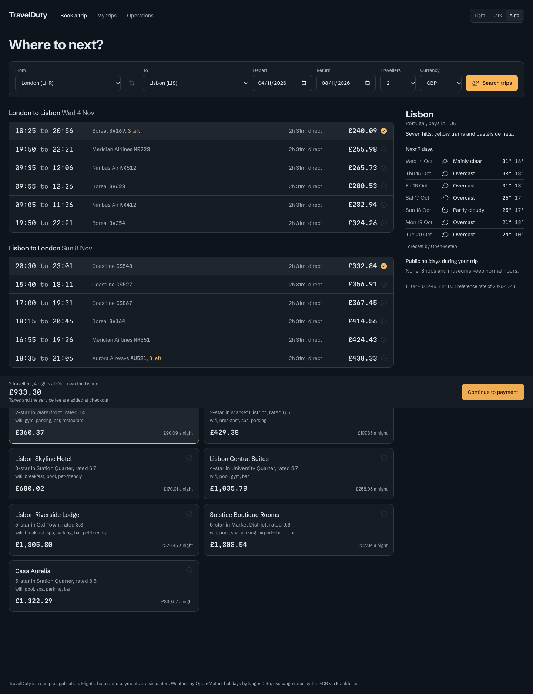
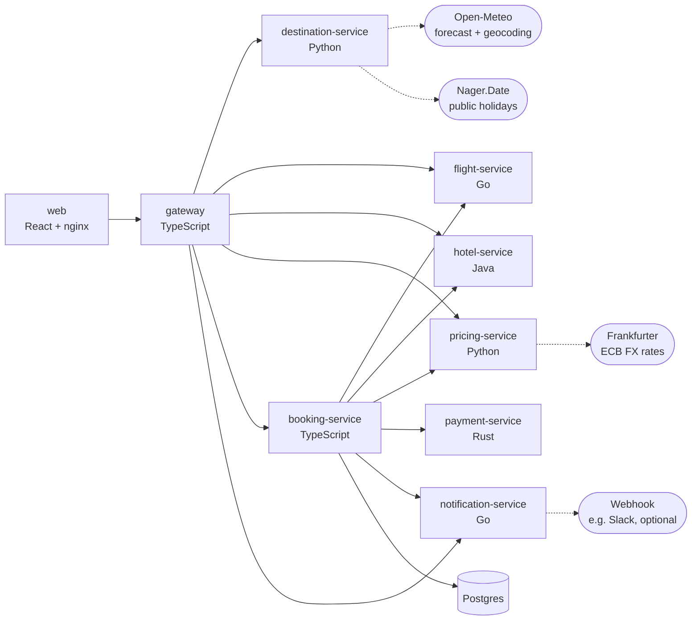

# TravelDuty

A sample travel company built as a **polyglot microservice platform**: eight services in five languages
that search flights and hotels, price trips in the traveller's currency, take payment and book everything
through a compensating saga. Inventory and payments are simulated. Weather, public holidays and exchange
rates come from **real public APIs**.

It is designed for demos of incident response and observability. Every service, whatever its language,
exposes the same health, readiness, Prometheus metrics, structured logs with request-id propagation, and
runtime **chaos controls** (latency and error injection).



## Architecture



| Service | Language / stack | Port | Responsibility | External calls |
|---|---|---|---|---|
| `gateway` | TypeScript, Fastify | 8080 | Public `/api`, trip-search aggregation, ops + chaos proxy | |
| `destination-service` | Python, FastAPI | 8081 | Destination catalogue, weather, holidays, geocoding | Open-Meteo, Nager.Date |
| `flight-service` | Go, net/http | 8082 | Deterministic flight inventory, seat holds, ticketing | |
| `hotel-service` | Java 17, Spring Boot | 8083 | Hotel inventory, nightly pricing, room holds | |
| `pricing-service` | Python, FastAPI | 8084 | FX rates, currency conversion, quotes with taxes/fees | Frankfurter (ECB) |
| `booking-service` | TypeScript, Fastify, Postgres | 8085 | Booking saga with compensation, booking store | |
| `payment-service` | Rust, axum | 8086 | Simulated card processor, idempotency, refunds | |
| `notification-service` | Go, net/http | 8087 | Customer notifications (simulated email, optional webhook) | Any webhook URL |
| `web` | React, Vite, Tailwind | 3000 | Booking UI, My trips, Operations panel | |

The cross-language contract (endpoints, payloads, error envelope, chaos semantics, hold lifecycle,
seeded generators) is in [`docs/contract.md`](docs/contract.md).

### The booking saga

`POST /api/bookings` runs in `booking-service`:

1. Hold outbound seats (flight-service), then return seats, then a hotel room (hotel-service)
2. Price the trip in the traveller's currency (pricing-service, live ECB rate)
3. Charge the card (payment-service, with an idempotency key)
4. Confirm the holds, which issues ticket numbers, a PNR and a hotel confirmation code
5. Notify the customer (best effort, never fails the booking)

If any step fails, the completed steps are undone in reverse order: holds are released and the charge is refunded.
The booking is stored as `FAILED` with the failing step, and its timeline records each compensation.
Card declines come back as `402`, sold-out inventory as `409`, and dependency outages as `502`/`504`.

## Run it

Requires Docker.

```bash
docker compose up --build -d          # or: make up
open http://localhost:3000            # web
curl localhost:8080/api/status        # every service's health
node scripts/e2e.mjs                  # or: make e2e — 22 end-to-end checks
```

Add Prometheus (http://localhost:9090) and Alertmanager (http://localhost:9093). Prometheus scrapes every
service every 5s; the rules in `ops/prometheus/alerts.yml` page PagerDuty within ~30s when a service is down,
fails over 5% / 20% of requests, or its p95 latency passes 1s / 3s. Set `PAGERDUTY_ROUTING_KEY` in `.env` first:

```bash
docker compose --profile observability up --build -d
```

Optional environment (see `.env.example`):

| Variable | Effect |
|---|---|
| `WEBHOOK_URL` | notification-service also POSTs `{"text": …}` here, e.g. a Slack incoming webhook or webhook.site |
| `ADMIN_TOKEN` | Protects every `/admin/*` endpoint; send it as `x-admin-token` |
| `ADMIN_USERNAME`, `ADMIN_PASSWORD` | Sign-in for the Operations tab's chaos controls (an 8-hour HttpOnly session cookie). 5 failed sign-ins lock an IP out for 15 min; 20 across all IPs lock sign-in for 5 min |
| `PAGERDUTY_ROUTING_KEY` | Events API v2 key Alertmanager pages (observability profile) |
| `CHAOS_ERROR_RATE`, `CHAOS_LATENCY_MS`, … | Start services already degraded |

### Sample cards

| Number | Result |
|---|---|
| `4242 4242 4242 4242` | Captured |
| `5555 5555 5555 4444` | Captured (Mastercard) |
| `4000 0000 0000 0002` | Declined: `generic_decline` |
| `4000 0000 0000 9995` | Declined: `insufficient_funds` |
| `4000 0000 0000 0069` | Declined: `expired_card` |
| `4000 0000 0000 0119` | Processor unavailable (502), simulating an acquirer outage |

## Break it (chaos)

Every service accepts `GET/PUT/DELETE /admin/chaos`. The gateway exposes all of them under one door, and
the **Operations** tab in the web app has sliders for them. When `ADMIN_USERNAME`/`ADMIN_PASSWORD` are set
the tab asks you to sign in first; with `ADMIN_TOKEN` set, curl calls need `-H "x-admin-token: …"`.

```bash
# 30% of payment-service requests fail with 503
curl -X PUT localhost:8080/api/admin/chaos/payment-service -H 'content-type: application/json' -d '{"errorRate":0.3}'

# hotel-service gets 2-3 s slower
curl -X PUT localhost:8080/api/admin/chaos/hotel-service -H 'content-type: application/json' -d '{"latencyMs":2000,"jitterMs":1000}'

curl localhost:8080/api/admin/chaos                          # all services' chaos state
curl -X DELETE localhost:8080/api/admin/chaos/payment-service  # back to normal
```

What to expect:

- Hotels, destination info or FX down: trip search still answers, with `degraded: [...]` and EUR prices if needed.
- Flights down: trip search fails with `502`, because there is nothing to sell.
- Payments failing: bookings fail cleanly and holds are released. Watch `bookings_total{status="FAILED"}` climb.
- Notifications down: bookings still confirm, and the booking timeline records the failed notification.

Useful metrics: `http_requests_total`, `http_request_duration_seconds`, `upstream_calls_total{target,outcome}`
and `bookings_total{status}`. Every log line is JSON and carries `requestId`, so you can follow one request
across all eight services with `docker compose logs | grep <request-id>`.

## Synthetics

`services/synthetics` runs simulated users (3 by default, `SYNTHETICS_USERS`) through the gateway around
the clock, so every service always has traffic and the error and latency alerts always have something to
measure. Each user loops through a weighted mix of journeys with a 1-4s pause between them:

| Journey | Weight | Calls | Services exercised |
|---|---|---|---|
| `browse` | 4 | destinations, one destination, currencies | destination, pricing |
| `search` | 4 | destinations, trip search | destination, flight, hotel, pricing |
| `book` | 1 | search, book (card 4242), fetch booking, notifications, cancel | all eight |
| `my-trips` | 1 | bookings by email | booking |

Bookings are cancelled straight away, which releases the seats and room and refunds the charge, so
synthetic traffic never uses up inventory. A cancellation that fails (say, under chaos) is retried before
the next booking. Synthetic requests carry `x-request-id: syn-<journey>-…` and the user agent
`TravelDuty-Synthetics`; their bookings use `synthetic.user<N>@travelduty.test`.

It exports `synthetic_journeys_total{journey,outcome,step}` (outcome `ok`, `degraded`, `sold_out` or
`failed`, with the failing step) and `synthetic_journey_duration_seconds`. `TravelDutySyntheticJourneyFailing`
pages when more than half of a journey's runs fail, and `TravelDutySyntheticsDown` warns when synthetic
traffic stops. `GET :8088/status` shows the last result and failure per journey;
`POST :8088/admin/synthetics/pause` and `/resume` (with `x-admin-token`) stop and start it.

### Clear-down

Synthetic traffic would otherwise grow every store forever, so each service clears down after itself,
every minute, with nothing to run by hand. Records are deleted once they have been finished for
`CLEARDOWN_RETENTION_MINUTES` (default 60):

| Service | Deletes | Never deletes |
|---|---|---|
| booking-service (Postgres) | cancelled or failed bookings on `@travelduty.test` | any real customer's booking; confirmed bookings |
| flight-service, hotel-service | cancelled and expired holds | held or confirmed seats and rooms |
| payment-service | fully refunded payments, idempotency keys | captured payments |
| notification-service | notifications to `@travelduty.test` | real customers' notifications |

Synthetics also cancels any of its own bookings still confirmed after 5 minutes (orphaned by a restart
mid-booking), so those get cleared too. Each sweep counts what it removed in
`cleardown_records_total{service,store}`.

## Develop

Toolchains: Node 20, Go 1.23+, Python 3.12 via [uv](https://docs.astral.sh/uv/), Java 17 (the Maven wrapper
is included), and Rust stable. `make help` lists all targets.

```bash
make install     # npm ci, uv sync, maven deps, cargo fetch
make test        # every suite: TS, Go, Python, Java, Rust
make test-live   # tests that call the real Open-Meteo, Nager.Date and Frankfurter APIs
```

Per language:

| Language | Location | Test | Run locally |
|---|---|---|---|
| TypeScript | `services/gateway`, `services/booking-service`, `libs/ts-common` | `npx vitest run services/booking-service` | `npm run dev -w @travelduty/booking-service` |
| Go | `services/flight-service`, `services/notification-service`, `libs/go-platform` | `go test ./services/flight-service/...` | `cd services/flight-service && go run .` |
| Python | `services/destination-service`, `services/pricing-service`, `libs/py-common` | `uv run pytest services/pricing-service` | `uv run destination-service` |
| Java | `services/hotel-service` | `cd services/hotel-service && ./mvnw test` | `./mvnw spring-boot:run` |
| Rust | `services/payment-service` | `cd services/payment-service && cargo test` | `cargo run` |
| Web | `apps/web` | `npm run typecheck -w @travelduty/web` | `npm run dev -w @travelduty/web` (port 5317, proxies `/api` to :8080) |

Every service defaults to `localhost` URLs for its peers, so running a few natively next to
`docker compose up` works. Stop the container you are replacing first.

Kubernetes manifests live in [`k8s/`](k8s/README.md) (`kubectl apply -k k8s/`).

## Layout

```
apps/web/                 React front end (served by nginx in Docker)
services/<name>/          one directory per service, each with its own Dockerfile
services/synthetics/      simulated users that keep traffic flowing for the alerts
libs/ts-common/           TS platform: service bootstrap, resilient HTTP client, chaos, metrics, cache
libs/go-platform/         Go platform: same contract for the Go services, plus generic hold store
libs/py-common/           Python platform: same contract for the FastAPI services
data/airports.json        reference data shared by every language
docs/contract.md          the cross-language service contract
scripts/e2e.mjs           end-to-end checks against a running stack
k8s/                      Kubernetes manifests
ops/prometheus/           Prometheus scrape config and alert rules
ops/alertmanager/         Alertmanager routing and the PagerDuty incident template
```

## Data sources

- [Open-Meteo](https://open-meteo.com): weather forecast and geocoding (CC BY 4.0)
- [Nager.Date](https://date.nager.at): public holidays
- [Frankfurter](https://frankfurter.dev): European Central Bank reference exchange rates

None of them need an API key. Responses are cached and served stale if the upstream is down.
Airlines, hotels and bookings are fictional.

## Licence

MIT, see [LICENSE](LICENSE).
